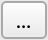
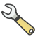

# Elevation, slope, and wind speed {#sec-e05}

> **Date of practical:** 6th and 13th November 2026

Elevation is a key determinant of many geographical processes. The height of the land determines whether the coast is above or below sea level. Mountain and valley slopes determine water flow and microclimates. Biomes are often restricted to particular altitudes. Digital Elevation Models (DEMs) describe land surface height in a grid, and are a special case of continuous geospatial data widely available as raster datasets at various spatial resolutions. QGIS has several tools to inspect and manipulate DEMs, which are necessary for the wind farm project.

::: {.callout-note}
## Learning objectives

To visualise DEMs and wind speed data, subset, classify and vectorize rasters, and create new slope and aspect rasters from DEMs. These steps are necessary for Map 3.
:::

## Adding rasters {#sec-addrast}

(@) Launch QGIS and create a new project

(@) From the `Wales_DEM` folder, add the `SRTM_Wales_DEM_25m.tif` layer to your project. This DEM is derived from the [Shuttle Radar Topography Mission](https://www.earthdata.nasa.gov/data/instruments/srtm){target='_blank'}, which scanned nearly 80% of Earth's land surfaces in 2000 to generate a DEM at 25 m resolution. Impressive!

(@) From the layer's symbology (right-click → `Properties...` → `Symbology`), experiment with the `Singleband pseudocolor` render type (see @sec-rasterdata):

    i. Click the drop-down arrow to the right of the `Color ramp`
    ii. Click `Create New Color Ramp...`
    iii. Under `Please select color ramp type:`, select `Catalog: cpt‑city` → `OK`. This 'city' of Colour Palette Tables (CPTs) is a repository of colour tables designed to creatively present raster data
    iv. Try out various colour ramps under the  `Topography` theme, and see which you prefer

(@) Open the layer's symbology again and experiment with adjusting:

    i. The `Color ramp`
    ii. The `Min` and `Max` values to be shown
    iii.The `Mode` of classification (`Continuous`, `Equal Interval`, and `Quantile`)
    iv. The number of `Classes`

## Inspecting rasters

(@) Install the `Value Tool` plugin (see @sec-geocoding). This tool allows you to interrogate data values as you pass the cursor over rasters

(@) Click the `Value Tool` icon ({width=3%})

(@) Use the `Value Tool` to answer the following:

```{r}
#| echo: false
#| message: false
#| results: asis
library(exams2forms)
exams2forms("E05_Q1.Rmd", edir = "exercises")
```

(@) Add the `Wales_operational_windfarms.gpkg` layer to your project

(@) Reflect on where these wind farms are located. How do their locations correlate with elevation?

## Clipping rasters {#sec-cliprast}

(@) Add your map tile to your project. As with vector layers, it is often much easier to process only the part of the Wales DEM that is within your map tile

(@) Clip the DEM to your map tile:

    i. Click `Raster` → `Extraction` → `Clip Raster by Mask Layer...`
    ii. Set `Input layer` to `SRTM_Wales_DEM_25m`
    iii. Set `Mask layer` to your map tile
    iv. Click the `Browse` icon ({width=3%}) next to `Clipped (mask)` to save the clipped raster to your OneDrive
    v. Click `Run` → `Close`
    vi. Turn off the visibility of the original (unclipped) raster
    vii. Have you saved your project recently?

(@) Explore your map tile's DEM using a suitable colour palette and different `Min / max` ranges

(@) Identify the highest point in your clipped DEM and, if possible, its name by Googling

## Viewing maps in 3D

(@)  View the clipped DEM in 3D:

    i. Click `View` → `3D Map Views` → `New 3D Map View`
    ii. Click the `Configure...` icon ({width=3%})
    iii. Click `Terrain`
    iv. Set `Type` to `DEM (Raster Layer)`
    v. Set `Elevation` to your clipped DEM
    vi. Set `Vertical scale` to `4` (higher values exaggerate or 'stetch' DEM values)
    vii. Set `Tile resolution` to `64 px`
    viii. Click `OK`
    ix. Use the mouse (by scrolling and holding down the click on the scroller) to explore the 3D map
    x. Experiment with different values of `Vertical scale` and `Tile resolution` to understand how these work
    xi. Add other layers to your Map Canvas to see them plotted in 3D

## Creating a slope raster

(@) Slope (gradient of the land surface) is a fundamental property of the land surface topography, and can provide valuable information on erosion potential, water flow, construction potential etc. Derive a slope raster from a DEM:

    i. Click `Raster` → `Analysis` → `Slope...`
    ii. Set `Input layer` as your clipped DEM
    iii. Click the `Browse` icon ({width=3%}) next to `Slope` to save the slope raster somewhere sensible
    iv. Click `Run` → `Close`
    v. Use the layer's legend to identify the steepest areas. Why are they there?

## Creating an aspect raster

(@) Aspect (compass direction towards which the gradient faces) is another fundamental property of land topography, providing information on insolation potential, where particular features are visible from, predominant wind exposure etc. Derive an aspect raster from a DEM:

    i. Click `Raster` → `Analysis` → `Aspect...`
    ii. Set `Input layer` as your clipped DEM
    iii. Click the `Browse` icon ({width=3%}) next to `Aspect` to save the aspect raster somewhere sensible
    iv. Click `Run` → `Close`

(@) An aspect of 1° (just East of North) is very close in meaning to an aspect of 359° (just West of North), yet they are at the opposite ends of the value range. A colour palette table with the same colour for both ends of the value range would make interpretation easier:

    i. Open the layer's symbology
    ii. Navigate to the `cpt‑city` Colour Palette Tables (CPTs) (see @sec-addrast)
    iii. Click the `All by author` tab
    iv. In the `Name` window, click `grass`
    v. In the `GRASS colour ramps` window, click `aspect`
    vi. Click `OK` → `OK`

## Creating a hillshade raster

(@) Hill shading simulates the effect of light falling on a surface by combining slope, aspect, and a solar illumination direction. This approach is commonly used to visualize topography in maps and figures. Derive a hillshade raster from a DEM:

    i. Click `Raster` → `Analysis` → `Hillshade...`
    ii. Set `Input layer` as your clipped DEM
    iii. Click the `Browse` icon ({width=3%}) next to `Hillshade` to save the aspect raster somewhere sensible
    iv. Click `Run` → `Close`
    v. From the `Layers` panel, turn off layer visibilities or arrange layers so that your hillshade layer is above your DEM layer
    vi. Change the hillshade transparency to `50%`
    vii. Change the symology of your DEM to something intuitive for land height (e.g. `Greens`). The effect should be quite pleasing!

(@) Create new hillshade rasters, but this time modify the following to improve the effect for your specific clipped DEM:

    i. `Z factor` (probably no more than 5)
    ii. `Azimuth of the light`
    iii. `Altitude of the light`

## Classifying raster data

(@) Use the raster calculator to perform cell-by-cell operations, such as to find parts of a raster layer within a specified range of values. One of the constraints for building a wind farm is that the land surface slope should be no more than 6 degrees. This is simply because greater slopes are less stable and not normally viable to build on. Build an expression in the raster calculator as follows:

    i. Click `Raster` → `Raster Calculator...` 
    ii. Under `Raster Bands`, double-click on the slope raster name you created earlier
    iii. In the `Raster Calculation Expression` window, add `<6`
    iv. Click the `Browse` icon ({width=3%}) next to `Output layer` to save the classified slope raster somewhere sensible
    v. Click `OK`
    
(@) The output raster has two values; `0` (black) and `1` (white). Given you instructed the raster calculator to identify areas of the raster that are less than 6°, what do you think these colours represent? Answer the following:

```{r}
#| echo: false
#| message: false
#| results: asis
library(exams2forms)
exams2forms("E05_Q2.Rmd", edir = "exercises")
```

## Converting to vector polygons

(@) Vector polygons can be created from raster layers so that they can be combined with other vector constraints such as those created in [chapter 4](#sec-e04). Convert the slope raster classifications to vector polygons:

    i. Click `Raster` → `Conversion` → `Polygonize (Raster to Vector)...`
    ii. Set `Input layer` as your classified slope layer
    iii. Set `Name of the field to create` as `Suitable`
    iv. Click `Run` → `Close`

(@) Polygons now demarcate the areas that are suitable (slope < 6°) or unsuitable (slope > 6°) for building upon. Open the attribute table to explore which is which. Think binary; under the 'Suitable' column, 1s represent 'yes', 0s represent 'no'

(@) Visualise the suitable and unsuitable areas for construction in the symbology (see @sec-catvec)

(@) Select the 'unsuitable' polygons (Suitable = 0) using `Select features using an expression` (see @sec-selexpress)

(@) Export the selected polygons (remember to use the `Save Selected Features As...` option). Name and store sensibly

## Preparing for Map 3

(@) From the `Wales_mean_windspeed` folder, add the `Wales_wind-speed_50m.tif` layer to your project

(@) Read over the `description_and_data_source.txt` file in the `Wales_mean_windspeed` folder for details about the data (Note: every GIS file has an associated `description_and_data_source.txt`)

(@) Clip the wind speed raster to your tile and save it somewhere sensible (see @sec-cliprast)

(@) Visualise the data using a suitable colour palette

(@) Add the constraint layers you created in Exercise 04 (see @sec-e04)

(@) With the wind speed layer beneath constraints, explore where development may be permitted and is optimal. You can explore not just where building a wind farm may be permitted, but where the windiest (best power generation) and largest (most number of turbines possible) plots of land are located in your map tile area

(@) Design Map 3 to clearly show the best unconstrained wind farm location, and use the various tools (e.g raster calculator) to extract information to help you justify why this area was selected (e.g. by providing additional information in your caption)

::: {.callout-note}
## Learning outcomes

By the end of this exercise you should be able to:

1. Visualise raster elevation data using pseudocolour ramps, cpt-city palettes, and min/max scaling, and interrogate cell values directly with the Value Tool.
2. Clip raster layers to an area of interest and explore the resulting surface in three dimensions.
3. Derive slope, aspect, and hillshade rasters from a DEM, and explain what each reveals about surface topography and geophysical process.
4. Classify raster data with the raster calculator to identify areas meeting a defined threshold, and convert the result to vector polygons for combination with other constraint layers.
5. Appreciate how elevation, slope, and wind speed interact to determine site suitability, integrating raster-derived constraints into a justified development decision.
:::
