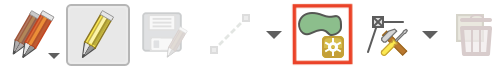

# Wind farm area polygon, viewshed, and impact {#sec-e06}

> **Date of practical:** 20th, 23rd, and 25th November 2026

This exercise is all about applying the skills you've gained over the past five exercises, to cement your GIS skills and successfully complete the wind farm project. You will also learn how to create a new polygon (to represent your wind farm location), calculate how many wind turbines could fit in the area, and create a viewshed to identify who may be impacted by the wind farm development.

::: {.callout-note}
## Learning objectives

Create and edit a polygon to represent a wind farm, calculate how many turbines fit in the area, create a viewshed, and count the population living within view of the proposed wind farm. These steps are necessary for Map 4.
:::

## Creating a wind farm polygon

(@) Launch QGIS and create a new project

(@) Add your constraint and map tile DEM layers (created in previous exercises)

(@) Create a new GeoPackage vector layer representing your optimal wind farm location:

    i. Click `Layer` → `Create Layer` → `New GeoPackage Layer...`
    ii. Click the `Browse` icon ({width=3%}) next to `Dataset` to save the wind farm location vector somewhere sensible
    iii. Set `Geometry type` as `Polygon`
    iv. Set the CRS as `EPSG:27700`
    v. Click `OK`
    vi. From the `Layers` panel, right‑click on the new layer and click `Toggle Editing` or find the shortcut ({width=3%})
    
        You can tell when a layer's in edit mode, as a pencil icon appears over the layer's symbol. Edits are temporary until you save them. This allows you to undo any mistakes you may have made. But beware - once saved, mistakes can't be easily undone!  

    vii. From the `Digitizing Toolbar`, click `Add Polygon Feature`
    
    {fig-align='center' width=50%}
    
    viii. Left‑click on the Map Canvas to draw vertices (points), outlining your optimum wind farm location
    ix. Once your polygon is complete, right‑click to finish
    x. Click `OK` 
    xi. If necessary, adjust the polygon by:
        a. Clicking the `Vertex Tool` ({width=3%}) 
        b. Selecting a polygon vertex 
        c. Moving the cursor to the desired location and pressing left-click
    xii. Click the `Toggle Editing` icon ({width=3%}) once more to turn off editing
    xiii. Click `Save`

::: {.callout-tip}
## Enable snapping

Are you a perfectionist, but you can't get the edge of your optimum wind farm area to abut a constraint layer? Well the snapping tool is for you! This will pull the cursor up against the edge of a vector layer to aid in the perfect placement of vertices. Try it out by clicking `View` → `Toolbars` → `Snapping Toolbar`, then clicking the `Enable Snapping` icon ({width=3%}).
:::

## Calculating number of wind turbines that can be built

(@) The local planning authority wish to install 50 m turbines across the site, that each generate 750kWh. How can you identify the most efficient way to pack turbines in your polygon? A grid of hexagons is often the most space-efficient regular packing arrangement. Create a hexagonal grid across your polygon:

    i. Click `Vector` → `Research Tools` → `Create Grid...`
    ii. Set `Grid type` as `Hexagon (Polygon)`
    iii. Under `Grid extent`, click the drop-down arrow → `Calculate from Layer` → select your wind farm location polygon
    iv. Set `Horizontal spacing` and `Vertical spacing` to `100` metres
    v. Set `Grid CRS` as `EPSG:27700`
    vi. Click `Run` → `Close`
    
(@) Delete the hexagons that extend beyond your windfarm polygon:

    i. Click `Vector` → `Research Tools` → `Select By Location...`
    ii. Set `Select features from` as your hexagon `Grid` layer 
    iii. Check `overlap` and `disjoint` only
    iv. Set `By comparing to the features from` to your windfarm polygon
    v. Click `Run`
    vi. Select the `Grid` layer in the `Layers` panel
    vii. Click the `Toggle Editing` icon ({width=3%}) to turn on editing
    viii.Click the `Delete Selected` icon ({width=3%}) to delete the unnecessary hexagons
    ix. Click the `Toggle Editing` icon ({width=3%}) once more to turn off editing
    x. Click `Save`

(@) Mark the location of the proposed wind turbines by creating a point in the middle of each hexagon:

    i. Click `Vector` → `Geometry Tools` → `Centroids...`
    ii. Set `Input layer` to the `Grid` layer
    iii. Click `Run` → `Close`
    iv. Save the centroids layer to somewhere sensible
    v. Remove the (now redundant) hexagon grid layer
    
(@) Check the following:

    i. Calculate the area of your windfarm polygon (see @sec-fieldcalc)
    ii. Check the distance between your wind turbine points
    iii. Use the attribute table to count the number of turbines your windfarm contains
    iv. Modify the symbology of your wind turbine points
    v. Calculate the potential energy output of your windfarm in kWh (each turbine can generate 750kWh)

## Creating a viewshed

(@) A viewshed uses a DEM to determine the inter-visibility between one point in the landscape and another. This is very valuable in exploring the potential visual impact of planned infrastructure such as a windfarm. The tool assumes you want to find everywhere (all `Targets`) in the landscape that an `Observer` can see from their location. We actually want to find everywhere in the landscape from where a target can be seen. The Viewshed tool works the same way in both cases, but we need to exchange `Observer` with `Target`. Creating a viewshed is a two-stage process:

    i. Select one the points near the centre of your windfarm polygon
    ii. Install the `Visibility Analysis` plugin (`Plugins` → `Manage and Install Plugins...`)
    iii. Click the `Toolbox` icon ({width=3%}) to activate the `Processing Toolbox`
    iv. Click `Visibility analysis` → `Create viewpoints` → `Create viewpoints`
    v. Set `Observer location(s)` to your wind turbine points
    vi. Check `Selected features only`
    vii. Set `Digital elevation model` to your map tile DEM
    viii. Set `Radius of analysis, meters` to 10 km
    ix Set `Observer height, meters` to the height of your wind turbines (50 m)
    x. Set `Target height, meters` to the height of an average person (1.7 m)
    xi. Click `Run` → `Close`
    
    A specific type of point layer has now been created, which is required for the remaining steps:

    xii. Under the `Processing Toolbox`, click `Visibility analysis` → `Analysis` → `Viewshed`
    xiii. Set `Observer location(s)` to `Output layer`
    xiv. Set `Digital elevation model` to your map tile DEM
    xv. Click `Run` → `Close`
    
(@) The output raster has two values; `0` (black) and `1` (white). By comparing your viewshed against your map tile DEM, what do you think these colours represent? Answer the following:

```{r}
#| echo: false
#| message: false
#| results: asis
library(exams2forms)
exams2forms("E06_Q1.Rmd", edir = "exercises")
```

## Calculating visibility impacts for Map 4

(@) Vectorize your viewshed to create polygons representing areas within 10 km from which the wind farm is visible:

    i. Use the `Polygonize...` tool to convert the raster to a vector (see @sec-polygonize)
    ii. Use the `Select features using an expression` tool to select the areas the windfarm can be seen (see @sec-selexpress)
    iii. Save the selected features somewhere sensible 

(@) Using skills from @sec-e03, calculate the following:

    i. The total number of people registered at postcodes within line‑of‑sight of your proposed windfarm
    ii. The proportion of the total population in your map tile that can see the windfarm

(@) Design Map 4 to effectively present the wind farm extent and its visual impact (consider using the visualisation skills learned in @sec-e05 to make your map look impressive), and use your skills to extract relevant information about population statistics and landscape visibility - even beyond your map tile if you so choose

::: {.callout-note}
## Learning outcomes

By the end of this exercise you should:

1. Create and edit a vector layer in QGIS.
2. Create a new polygon layer to represent a proposed wind farm location.
3. Calculate the area of a vector polygon and estimate turbine capacity.
4. Create a viewshed using an observer/target and a DEM.
5. Quantify population within sight of the proposed wind farm and its proportion of the tile population.
:::
